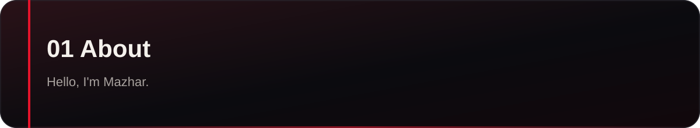
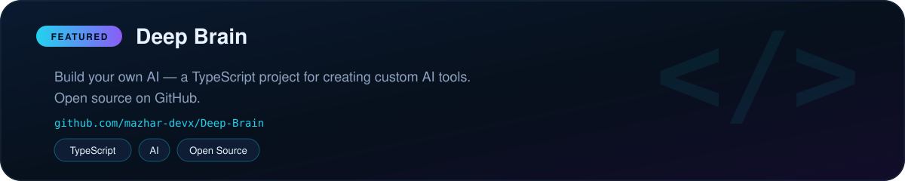
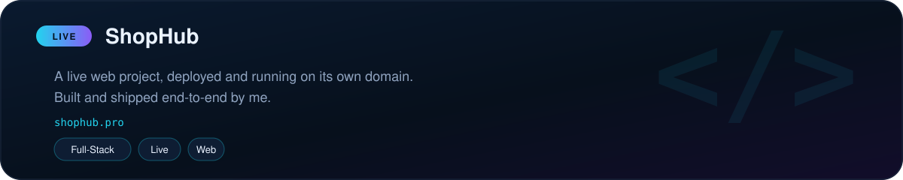
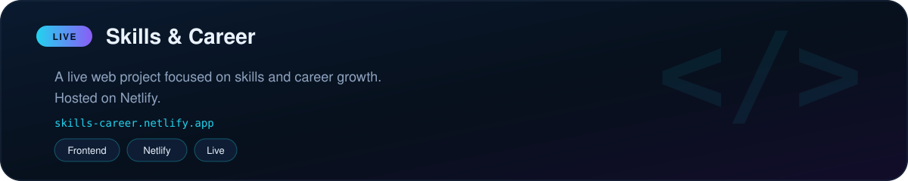
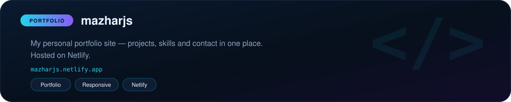
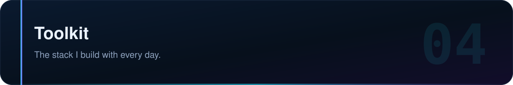
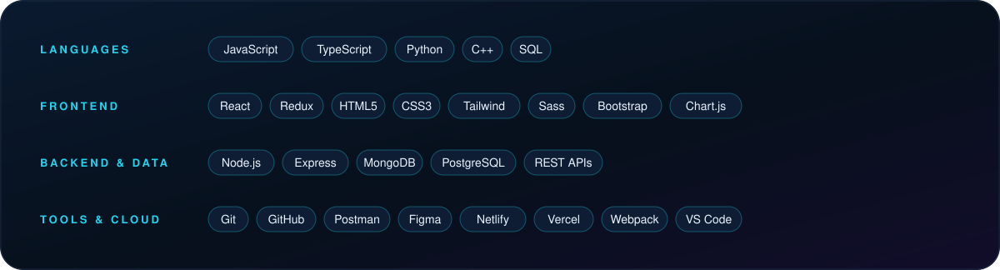
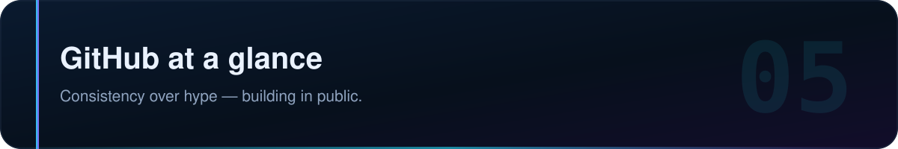
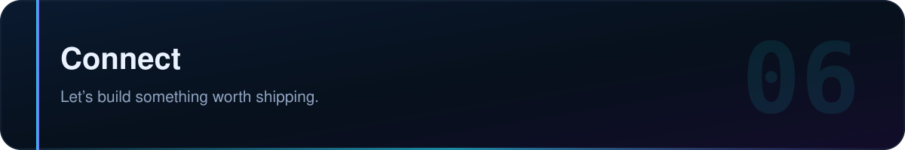
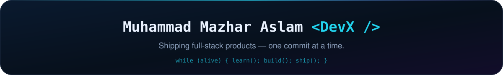

  

  
  
  
  

  

 

| | |
|---|---|
| 👤 **Name** | Muhammad Mazhar Aslam — known online as **DevX** |
| 🎯 **Focus** | Full-Stack Development · MERN Stack · Cloud Engineering · Scalable solutions |
| 🌱 **Learning** | Advanced MERN stack · Redux · Backend automation |
| 💬 **Ask me about** | HTML, CSS, Tailwind CSS, Vanilla JS, React, Redux, Node.js, Express, MongoDB, Python, C++, Chart.js |
| ⚡ **Fun fact** | I love building projects that solve real-world problems |
| 📫 **Reach me** | [mazhar.devx@gmail.com](mailto:mazhar.devx@gmail.com) |

#### 📌 Pinned on GitHub

  

<b>More things I build</b> — MERN apps and tools

 

| Project type | What it covers | Stack |
|---|---|---|
| **E-Commerce App** | Login, checkout, payments, admin panel, real-time cart updates | React · Node.js · Express · MongoDB · Tailwind CSS |
| **Subscription & Expense Tracker** | Multi-user tracking with charts and analytics | React · Node.js · MongoDB · Chart.js · Tailwind CSS |
| **Real-time Chat App** | Live messaging, file uploads, emojis and reactions | React · Node.js · Socket.IO · Express · MongoDB |
| **Portfolio Website** | Responsive, dark/light mode, animated sections | React · Tailwind CSS · Framer Motion |

[All repositories →](https://github.com/mazhar-devx?tab=repositories)

<b>Full icon wall</b>

 

  
  

  

  

  <picture>
    <source media="(prefers-color-scheme: dark)" srcset="https://raw.githubusercontent.com/mazhar-devx/mazhar-devx/output/github-snake-dark.svg">
    <source media="(prefers-color-scheme: light)" srcset="https://raw.githubusercontent.com/mazhar-devx/mazhar-devx/output/github-snake.svg">
    
  </picture>

  
  
  
  
  

