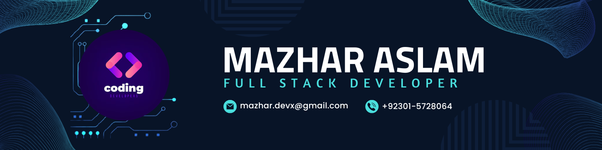

<!-- Banner -->

<!-- Animated Typing Intro -->
<h1 align="center">Hi 👋, I'm Mazhar Aslam</h1>
<h3 align="center">
  
</h3>

<!-- Profile GIF -->

<!-- Profile Views -->

 
   

- 💬 Ask me about **HTML, CSS, TailwindCSS, Vanilla JS, React, Redux, Node.js, Express, MongoDB, Python, C++, Chart.js**
- 🌱 Currently learning **Advanced MERN stack, Redux, Backend Automation**
- ⚡ Fun fact: I love building **projects that solve real-world problems**
- 📫 Reach me at **[mazhar.devx@gmail.com](mailto:mazhar.devx@gmail.com)**

---

### 🔗 Connect with Me

---

### 🛠️ My Skills

Click to expand all languages, frameworks, and tools

<!-- Languages -->
 

<!-- Frameworks & Libraries -->

<!-- Tools & Platforms -->

---

### 💻 My Projects

Click to expand my ultra-project showcase

#### 1. MERN E-Commerce App
- **Features:** Login, Checkout, Payments, Admin Panel, Real-time Cart Updates
- **Tech Stack:** React, Node.js, Express, MongoDB, TailwindCSS
- 

#### 2. Subscription & Expense Tracker (Multi-User)
- **Features:** Add, Delete, Update Expenses, Charts, Analytics
- **Tech Stack:** React, Node.js, MongoDB, Chart.js, TailwindCSS
- 

#### 3. Chat App (React + Node + Socket.IO)
- **Features:** Real-time Messaging, File Uploads, Emojis, Reactions
- **Tech Stack:** React, Node.js, Socket.IO, Express, MongoDB
- 

#### 4. Portfolio Website
- **Features:** Responsive, Interactive, Dark/Light Mode, Animated Sections
- **Tech Stack:** React, TailwindCSS, Framer Motion
- 

---

### 📊 GitHub Stats & Activity

---

### ⏱️ WakaTime Coding Stats

---

### 🎖️ Fun Badges & Achievements

---

### ⚡ Ultra Pro Tips
1. Replace all `yourgif.gif` links with **real GIFs/screenshots** of your projects.
2. Replace `your-wakatime-username` with your **actual WakaTime username**.
3. Keep updating **projects, badges, skills, and streaks** regularly.
4. You can add **animated SVGs or skill bars** using services like [shields.io](https://shields.io/) or [readme-typing-svg](https://readme-typing-svg.herokuapp.com/).
5. Add **custom sections** like “Recent Blog Posts” or “Open Source Contributions” with GitHub Actions for auto-updates.

