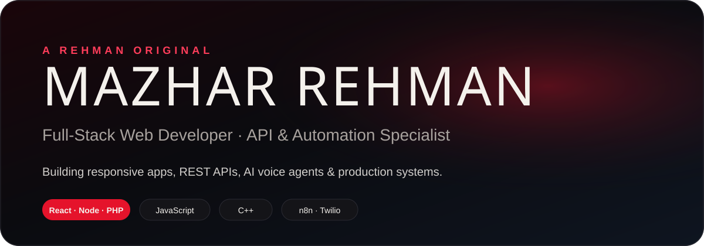
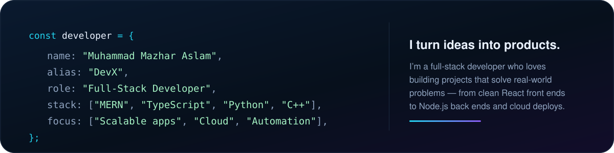
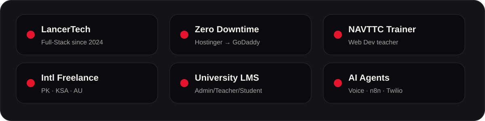
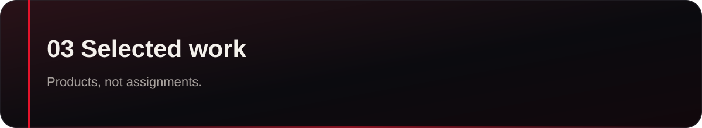
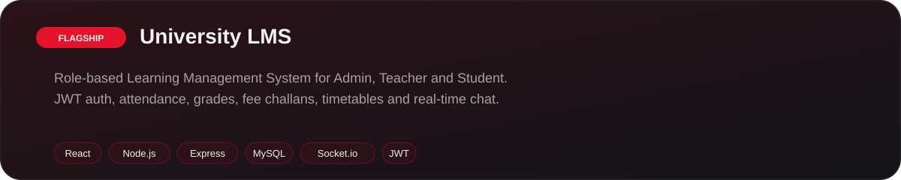
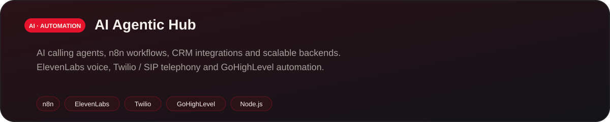
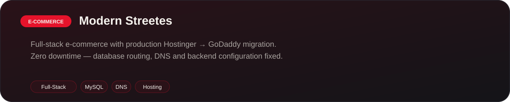
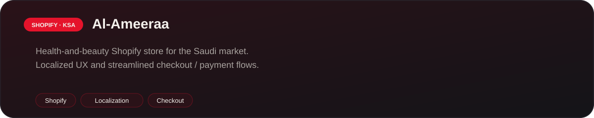

  

  
  
  
  

  

 

| | |
|---|---|
| 🎯 **Focus** | Full Stack Developer · MERN Stack · Cloud Engineering · Building scalable solutions |
| 💼 **Now** | Full-Stack Web Developer at **LancerTech** (since Feb 2024) |
| 🎓 **Education** | BSCS — Riphah International University, Lahore (2022 – 2026) |
| 🧑‍🏫 **Teaching** | Web Development Trainer at **NAVTTC** |
| 🌍 **Clients** | Pakistan · Saudi Arabia · Australia |
| 🌱 **Learning** | Advanced MERN stack · Redux · Backend automation |
| 💬 **Ask me about** | HTML, CSS, TailwindCSS, Vanilla JS, React, Redux, Node.js, Express, MongoDB, MySQL, Python, C++, Chart.js, n8n, REST APIs |
| ⚡ **Fun fact** | I love building projects that solve real-world problems |

  

#### 📌 Pinned on GitHub

  
  

<b>More things I've built</b> — MERN apps, tools and sites

 

| Project | What it does | Stack |
|---|---|---|
| **MERN E-Commerce App** | Login, checkout, payments, admin panel, real-time cart updates | React · Node.js · Express · MongoDB · Tailwind CSS |
| **Subscription & Expense Tracker** | Multi-user tracker: add, edit, delete expenses with charts and analytics | React · Node.js · MongoDB · Chart.js · Tailwind CSS |
| **Real-time Chat App** | Live messaging, file uploads, emojis and reactions | React · Node.js · Socket.IO · Express · MongoDB |
| **Portfolio Website** | Responsive, interactive, dark/light mode, animated sections | React · Tailwind CSS · Framer Motion |
| **[Deep Brain](https://github.com/mazhar-devx/Deep-Brain)** | Build your own AI — a TypeScript project | TypeScript |

**Live sites & side projects:**
[ShopHub](https://www.shophub.pro/) · [Skills & Career](https://skills-career.netlify.app/) · [mazharjs](https://mazharjs.netlify.app/) · [All repos on `mazhar-devx`](https://github.com/mazhar-devx?tab=repositories)

 

**Languages**
 

 

**Frontend**
 

 

**Backend & Data**
 

 

**Automation, AI & CRM**
 

 

**Tools & Hosting**
 

<b>Click to expand the full icon wall</b>

 

  
  

  

  

  <picture>
    <source media="(prefers-color-scheme: dark)" srcset="https://raw.githubusercontent.com/anonymouskh09/anonymouskh09/output/github-snake-dark.svg">
    <source media="(prefers-color-scheme: light)" srcset="https://raw.githubusercontent.com/anonymouskh09/anonymouskh09/output/github-snake.svg">
    
  </picture>

<b>Earlier account: <code>mazhar-devx</code></b>

 

  
  

  
  
  
  

  
  
  
  
  

